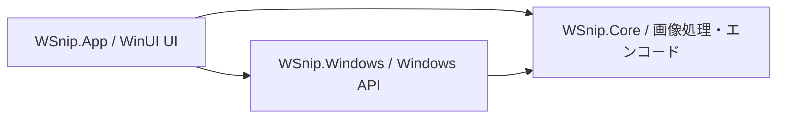
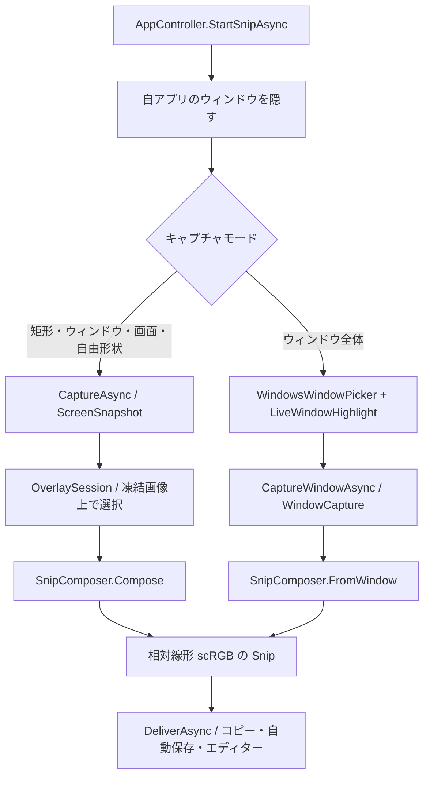

# 実装ガイド

現行の Windows / WinUI 3 実装の案内。ビルド・実行・検証は [development.md](development.md)、利用者向けの仕様は [README](../README.md) を参照する。
行番号は変更でずれるため、ファイル名と型・メソッド名を起点に探す。

## プロジェクトの境界

- [WSnip.App.csproj](../src/WSnip.App/WSnip.App.csproj): 実行ファイル。WinUI、Win2D、SkiaSharp を使用する。
- [WSnip.Windows.csproj](../src/WSnip.Windows/WSnip.Windows.csproj): キャプチャ、入力フック、シェルなどの Windows 実装。
- [WSnip.Core.csproj](../src/WSnip.Core/WSnip.Core.csproj): UI から独立したデータ・画像処理とプラットフォームサービスの契約。
- [WSnip.Rendering.Tests.csproj](../tests/WSnip.Rendering.Tests/WSnip.Rendering.Tests.csproj): Core / Windows を参照し、`SharedImage.cs` と `SnipDrawing.cs` をリンクして描画計算を検証する。WinUI アプリ全体を起動するテストではない。

製品名は FluentWSnip だが、ソリューション、プロジェクト、名前空間の `WSnip` は意図的に残している。Avalonia の UI、Linux の実行プロジェクトは存在しない。

## 機能から実装を探す

### 起動・アプリ全体の進行

| ファイル | 主な責務・探す型やメソッド |
| --- | --- |
| [Program.cs](../src/WSnip.App/Program.cs) | エントリーポイント。WinRT 初期化、ログ、パッケージからの起動引数、二重起動時の引数転送、WinUI の UI スレッドを準備する。 |
| [App.xaml.cs](../src/WSnip.App/App.xaml.cs) | `App.OnLaunched` で `AppController` と設定ストアを作成。Debug の表示フィクスチャの入口もここ。 |
| [AppController.cs](../src/WSnip.App/Services/AppController.cs) | アプリ全体の進行役。`HandleArguments`、`StartSnipAsync`、`SnipWholeWindowAsync`、`DeliverAsync`、設定更新、トレイ、ホットキー、終了条件。機能追加時の最初の確認先。 |
| [AppWindowBase.cs](../src/WSnip.App/Services/AppWindowBase.cs) | WinUI ウィンドウの HWND、表示・非表示、位置・サイズ、枠なし最前面表示、ウィンドウ一覧と寿命。 |
| [NativeTray.cs](../src/WSnip.App/Services/NativeTray.cs) | 通知領域アイコンとネイティブメニュー。 |
| [MessageDialog.cs](../src/WSnip.App/Services/MessageDialog.cs)、[InputKeys.cs](../src/WSnip.App/Services/InputKeys.cs) | メッセージ表示、キー状態の取得。 |

### キャプチャと選択画面

| ファイル | 主な責務・変更時の注意 |
| --- | --- |
| [Overlay.cs](../src/WSnip.App/Capture/Overlay.cs) | 複数の型を含む。`OverlaySession` は矩形・ウィンドウ・画面・自由形状の選択状態、`OverlayWindow` は画面ごとの表示と入力、`OverlaySurface` は凍結背景と選択の描画。`SnipModeBar` と `WholeWindowToolbar` もこのファイル内。 |
| [OverlayDrawing.cs](../src/WSnip.App/Capture/OverlayDrawing.cs) | GPU 上で暗幕と選択枠を描く。矩形は重ならない四つの暗幕、自由形状は形状の差分を使う。 |
| [SnipModeOption.cs](../src/WSnip.App/Capture/SnipModeOption.cs) | モードの一覧、ローカライズされた表示名・説明。 |
| [WindowsScreenCaptureService.cs](../src/WSnip.Windows/Capture/WindowsScreenCaptureService.cs) | `CaptureAsync` は全画面、`CaptureWindowAsync` は一つの HWND を取得。Windows.Graphics.Capture の FP16 フレーム、カーソル、枠なしキャプチャ、タイムアウト、サイズ変更、失敗後のデバイス再作成。 |
| [Direct3DDevice.cs](../src/WSnip.Windows/Capture/Direct3DDevice.cs) | D3D11 / WinRT デバイスとテクスチャ読み戻し。 |
| [DisplayEnumerator.cs](../src/WSnip.Windows/Capture/DisplayEnumerator.cs) | モニター位置、DPI、HDR / Advanced Color、SDR 白、最大輝度。`DisplayInfo` の定義もここ。 |
| [WindowEnumerator.cs](../src/WSnip.Windows/Capture/WindowEnumerator.cs) | Z 順の候補列挙、DWM の可視フレーム、`WindowAt` によるヒット判定。自プロセス、非表示・最小化・cloaked ウィンドウなどを除外する。 |
| [WindowsWindowPicker.cs](../src/WSnip.Windows/Capture/WindowsWindowPicker.cs) | 「ウィンドウ全体」のライブ選択。専用メッセージスレッドのマウス・キーボードフックでクリックを捕捉し、Esc / 右クリックでキャンセル。システムカーソルの置換と復元も担当。 |
| [LiveWindowHighlight.cs](../src/WSnip.Windows/Capture/LiveWindowHighlight.cs) | ライブ選択の暗幕・影・白い枠。モニターごとに layered window とウィンドウ領域を使い、対象とツールバーをくり抜く。入力を透過し、アクティブ化しない。 |

### エディター・表示

| ファイル | 主な責務 |
| --- | --- |
| [EditorWindow.xaml](../src/WSnip.App/Editor/EditorWindow.xaml)、[EditorWindow.xaml.cs](../src/WSnip.App/Editor/EditorWindow.xaml.cs) | エディターのレイアウト、ドック、ツール操作、保存・コピー、確認ダイアログ、ピクセル情報、表示の更新。 |
| [EditorDocument.cs](../src/WSnip.App/Editor/EditorDocument.cs) | 画像とストロークの編集状態、undo / redo 履歴、`IsDirty`、クロップ、HDR / SDR プレビューのキャッシュ。`FlattenAsync` が注釈を焼き込んだ保存用 `Snip` を作る。 |
| [SnipCanvas.cs](../src/WSnip.App/Editor/SnipCanvas.cs) | ポインター入力、ペン・蛍光ペン・消しゴム、クロップ枠、ズーム・パン、ピクセルホバー、描画領域とドックの位置関係。 |
| [ColorEditor.xaml](../src/WSnip.App/Editor/ColorEditor.xaml)、[ColorEditor.xaml.cs](../src/WSnip.App/Editor/ColorEditor.xaml.cs) | カスタム色の編集 UI。 |
| [ToneMappingWindow.xaml](../src/WSnip.App/Editor/ToneMappingWindow.xaml)、[ToneMappingWindow.xaml.cs](../src/WSnip.App/Editor/ToneMappingWindow.xaml.cs) | トーンマッピングの曲線・パラメーターの UI、プレビューと確定。 |
| [HdrSurface.cs](../src/WSnip.App/Rendering/HdrSurface.cs) | 表示の共通基盤。Skia のラスタライズ結果を Win2D の FP16 scRGB swap chain に渡す。SDR フォールバック、DPI・表示状態の更新、初回フレーム完了、バッファ解放。 |
| [SnipDrawing.cs](../src/WSnip.App/Rendering/SnipDrawing.cs) | 画像、注釈、透明部分のチェック模様の共通 Skia 描画。 |
| [SharedImage.cs](../src/WSnip.App/Rendering/SharedImage.cs) | ネイティブ画素と色空間を Skia 画像に結び付け、参照カウントで保持する。 |
| [HdrImageView.cs](../src/WSnip.App/Rendering/HdrImageView.cs)、[ColorSwatch.cs](../src/WSnip.App/Rendering/ColorSwatch.cs) | HDR 対応の画像表示部品と色見本。 |
| [WindowsDisplayState.cs](../src/WSnip.Windows/WindowsDisplayState.cs) | ウィンドウの現在のモニターに対応する表示情報。 |

### 設定・テーマ・文字列

| ファイル | 主な責務 |
| --- | --- |
| [AppSettings.cs](../src/WSnip.Core/Settings/AppSettings.cs) | 設定モデル、既定値、JSON の `SettingsStore`。設定項目を足す際は UI と `AppController.UpdateSettings` も確認する。 |
| [SettingsWindow.xaml](../src/WSnip.App/Settings/SettingsWindow.xaml)、[SettingsWindow.xaml.cs](../src/WSnip.App/Settings/SettingsWindow.xaml.cs) | 設定画面の表示、値の初期化、変更の保存。 |
| [HotkeyRow.xaml](../src/WSnip.App/Settings/HotkeyRow.xaml)、[HotkeyRow.xaml.cs](../src/WSnip.App/Settings/HotkeyRow.xaml.cs) | ショートカットの入力と表示。 |
| [ThemeService.cs](../src/WSnip.App/Services/ThemeService.cs) | アプリの Light / Dark / System 指定、Mica、枠の色、テーマ関連イベントの管理。`Attach(..., manageShellBackdrop: false)` はテーマだけを連動し、ウィンドウ独自の背景を維持する。 |
| [App.xaml](../src/WSnip.App/App.xaml) | 共通スタイル。`SnipModeBarStyle` は標準アクリルブラシ、`DesktopSnipModeBarStyle` はデスクトップアクリルを見せる透明な背景。色は `ThemeResource` で解決する。 |
| [Strings/](../src/WSnip.Core/Strings) | `AppStrings.resx` が既定の en-US。`AppStrings.en-GB.resx`、`de-DE`、`es-ES`、`fr-FR`、`ja-JP`、`zh-CN`、`zh-TW` が翻訳。強く型付けされた `AppStrings` はビルド生成。 |

### Windows との接続

| ファイル | 主な責務 |
| --- | --- |
| [PlatformServices.cs](../src/WSnip.Core/Platform/PlatformServices.cs)、[WindowsPlatform.cs](../src/WSnip.Windows/WindowsPlatform.cs) | サービスの契約と Windows 実装の組み立て。`WindowsPlatform.AppId` はインスタンス分離の識別子。 |
| [WindowsSingleInstanceService.cs](../src/WSnip.Windows/WindowsSingleInstanceService.cs) | named mutex と current-user named pipe。後続起動の引数を既存プロセスへ送る。 |
| [WindowsHotkeyService.cs](../src/WSnip.Windows/WindowsHotkeyService.cs) | 専用スレッドでのグローバルホットキー登録・解除、競合の報告。 |
| [WindowsClipboardService.cs](../src/WSnip.Windows/WindowsClipboardService.cs) | PNG / DIB の即時クリップボード転送。アプリ終了後も貼り付けできるようにする。 |
| [WindowsFilePicker.cs](../src/WSnip.Windows/WindowsFilePicker.cs) | Windows のファイル選択 UI。 |
| [WindowsPackage.cs](../src/WSnip.Windows/WindowsPackage.cs) | パッケージ判定、MSIX の起動種別、設定・ログの保存先。 |
| [WindowsShellService.cs](../src/WSnip.Windows/WindowsShellService.cs) | 自動保存フォルダー、Explorer、既定アプリ設定、MSIX の startup task / 非パッケージの Run キー。 |
| [WindowsIntegrationService.cs](../src/WSnip.Windows/WindowsIntegrationService.cs) | DWM の枠・Mica 関連、キャプチャ除外、カーソル位置。 |
| [Native.cs](../src/WSnip.Windows/Interop/Native.cs) | Win32 / DWM / GDI の構造体、定数、P/Invoke 宣言。Windows キャプチャ UI のネイティブ処理を変更するときの確認先。 |

### 画像データと色処理

| ファイル | 主な責務 |
| --- | --- |
| [ScreenSnapshot.cs](../src/WSnip.Core/Capture/ScreenSnapshot.cs) | `DisplayColorInfo`、`MonitorCapture`、`CapturedWindow`、`ScreenSnapshot`、`WindowCapture`。画面の位置と取得時の色情報。 |
| [SnipMode.cs](../src/WSnip.Core/Capture/SnipMode.cs)、[Snip.cs](../src/WSnip.Core/Capture/Snip.cs) | キャプチャモード、取得結果の `Snip`、画面からの切り出しと正規化を行う `SnipComposer.Compose` / `FromWindow`。 |
| [OutlineMask.cs](../src/WSnip.Core/Capture/OutlineMask.cs) | 自由形状選択のアルファマスク。 |
| [HdrImage.cs](../src/WSnip.Core/Imaging/HdrImage.cs)、[PixelBuffer.cs](../src/WSnip.Core/Imaging/PixelBuffer.cs) | Half RGBA 画像、`PixelRect`、`ParallelRows` による行の並列処理、ネイティブバッファの参照カウント、共有ビューと行ストライド。 |
| [ScRgb.cs](../src/WSnip.Core/Imaging/ScRgb.cs)、[ColorMath.cs](../src/WSnip.Core/Imaging/ColorMath.cs) | scRGB / カスタム色、色域変換、伝達関数、輝度の定数。 |
| [HdrStatistics.cs](../src/WSnip.Core/Imaging/HdrStatistics.cs) | ピーク・輝度・色域の分析、HDR 判定、SDR ベースの色域選択。 |
| [ToneMapping.cs](../src/WSnip.Core/Imaging/ToneMapping.cs) | 曲線の種類、設定、パラメーター定義。曲線の実計算は `RenditionBuilder.cs` の `ToneCurve` も確認する。 |
| [RenditionBuilder.cs](../src/WSnip.Core/Imaging/RenditionBuilder.cs) | SDR ベースとゲインマップの生成、Adaptive / Global / Clip、アルファの処理。 |
| [DisplayRendition.cs](../src/WSnip.Core/Imaging/DisplayRendition.cs) | 表示先の HDR ヘッドルームに合わせたロールオフ。 |
| [GainMapMetadata.cs](../src/WSnip.Core/Imaging/GainMapMetadata.cs)、[PqImage.cs](../src/WSnip.Core/Imaging/PqImage.cs) | ゲインマップのメタデータ、BT.2100 PQ 画像の生成。 |
| [Annotations.cs](../src/WSnip.Core/Editing/Annotations.cs) | ストローク・ツールのデータ、Skia パスと描画設定、保存用の `AnnotationRenderer`。undo / redo 履歴は App の `EditorDocument` が持つ。 |

### 保存・エンコード

| ファイル | 主な責務 |
| --- | --- |
| [SnipExporter.cs](../src/WSnip.Core/Encoding/SnipExporter.cs) | `SnipFormat`、形式の利用可否、拡張子、ファイル名、HDR / SDR 分岐、エクスポートと一時ファイル経由の保存。新形式追加時の入口。 |
| [PngWriter.cs](../src/WSnip.Core/Encoding/PngWriter.cs) | SDR PNG と PQ の HDR PNG。 |
| [UltraHdrJpegWriter.cs](../src/WSnip.Core/Encoding/UltraHdrJpegWriter.cs)、[JpegSegments.cs](../src/WSnip.Core/Encoding/JpegSegments.cs) | JPEG の SDR ベース、ゲインマップ、MPF / XMP / ISO メタデータと JPEG セグメント。 |
| [HeifEncoder.cs](../src/WSnip.Core/Encoding/HeifEncoder.cs)、[HeifWriter.cs](../src/WSnip.Core/Encoding/HeifWriter.cs) | HEIC / AVIF のタイル、画像アイテム、ゲインマップ、HEIF コンテナー。 |
| [FfmpegStillEncoder.cs](../src/WSnip.Core/Encoding/FfmpegStillEncoder.cs)、[YuvConverter.cs](../src/WSnip.Core/Encoding/YuvConverter.cs) | FFmpeg の静止画エンコードと YUV 変換。エンコーダーの探索は共有 Light Player 側も参照。 |
| [JxlEncoder.cs](../src/WSnip.Core/Encoding/JxlEncoder.cs) | FFmpeg / libjxl を使う JPEG XL 出力。 |
| [Av1Bitstream.cs](../src/WSnip.Core/Encoding/Av1Bitstream.cs)、[HevcBitstream.cs](../src/WSnip.Core/Encoding/HevcBitstream.cs)、[BitReader.cs](../src/WSnip.Core/Encoding/BitReader.cs) | AV1 / HEVC のビットストリームと構成情報の読み取り。 |
| [SkiaImages.cs](../src/WSnip.Core/Encoding/SkiaImages.cs) | エンコード用の Skia 画像・画素ビュー。 |

## 起動から保存まで

起動は `Program.Main` → `App.OnLaunched` → `AppController.Start` → `HandleArguments`。
通常起動はエディター、`--snip [mode]` / `ms-screenclip:` はキャプチャ、`--background` はバックグラウンド起動に進む。二重起動時は先行プロセスに引数を転送する。

キャンセルなら既存の編集内容を保持して表示を戻す。新しい選択が確定した場合に前のドキュメントを退役させる。
モードバーで通常モードと「ウィンドウ全体」を切り替える際は、現在の選択 UI を終了して `StartSnipAsync` のループで別の経路へ進む。
エディターで保存・コピーするときは `EditorDocument.FlattenAsync` → `AppController` の保存 / コピー処理へ進む。

## 設計上の要点

### 凍結オーバーレイの性能と初期表示

`OverlaySurface` は `HdrSurface.CacheRaster` と `SynchronizeWithComposition` を有効にする。
背景は最初に描画・GPU 転送してキャッシュし、選択中は `OverlayDrawing` で暗幕と枠だけを描く。
入力を composition の更新単位にまとめ、`Present(0)` を使う。選択が触れないモニターは再描画しない。
背景を毎ポインターイベントで再ラスタライズ・再転送する変更は、4K / HDR での低 FPS を再発させる。

`OverlayWindow` は DWM cloak で隠して XAML をロードし、`HdrSurface.InitialFrameReady` と compositor の commit を待つ。
全モニターの `PrepareAsync` が揃ってから `Reveal` し、最後に選択側をアクティブにする。先に表示すると白い初期背景が見える。
初回は表示中の render tick に依存せず準備できるよう、DispatcherQueue 経由で描く。失敗・破棄時は初回待機も終了させる。

エディターの `SnipCanvas` は編集内容を毎回描く別の用途。凍結背景と同じキャッシュを一律に有効にすると編集や表示変更が反映されなくなる。

### ライブ選択の入力と寿命

`WindowsWindowPicker` の低レベルフック内では重い列挙・描画をしない。移動通知をまとめて picker スレッドへ送り、そこでホバーを調べる。
50ms のタイマーは、静止したポインターの下でウィンドウが動いた場合も追従するためにある。
`LiveWindowHighlight` は最初に自プロセスの操作用ウィンドウを記録し、暗幕・枠から除外する。
各領域は画面の物理ピクセルで計算する。`SetWindowRgn` 成功後の region は OS 所有なので二重解放しない。
フック、タイマー、暗幕ウィンドウ、カーソルは選択終了の `finally` で片付け、結果を返してからウィンドウ単独のキャプチャを開始する。

### テーマとアクリル

モードバーのテーマを Dark に固定しない。`ThemeService` がアプリの Light / Dark / System を選択画面にも適用する。
凍結画面上では `SnipModeBarStyle` の in-app acrylic、別ウィンドウの `WholeWindowToolbar` では `DesktopAcrylicBackdrop` と `DesktopSnipModeBarStyle` を使う。
これらは `manageShellBackdrop: false` でテーマ連動させる。通常のウィンドウ用 Mica / 不透明背景スタイルで上書きしない。
標準のテーマリソースはライト・ダーク・ハイコントラストや素材のフォールバックにも対応する。

### 色の単位と座標

- 取得直後の `MonitorCapture` / `WindowCapture` は Windows の scRGB。`DisplayColorInfo.WhiteScale` がその画面の SDR 白の大きさ。
- `SnipComposer` が各画面の SDR 白で正規化し、`Snip.Image` の `1.0` は相対的な SDR 白になる。`FromWindow` は未公開の取得画像をその場で正規化して共有する。
- `HdrSurface` は表示境界で現在の SDR 白を Windows の 80-nit 単位に戻す。途中の画像を `[0,1]` に制限したり、負の色成分を捨てたりしない。
- `Snip` は straight alpha、表示先の swap chain は premultiplied alpha。注釈の表示と焼き込みでこの区別を保つ。
- PQ 出力、SDR / クリップボード、HDR プレビューは目的の異なる変換。表示のロールオフを原画像に焼き込まない。
- `PixelRect`、キャプチャ範囲、ネイティブウィンドウ位置は物理ピクセル。WinUI のレイアウトと Skia の UI 座標は DIP。`RenderScaling` / `RasterScale` の変換を確認する。

### 画像の所有権

`PixelBuffer<T>`、`HdrImage`、`SharedImage` は寿命を明示的に管理する。別の処理に渡すときは `Share` / `AddRef` で保持し、`Dispose` / `Release` を対にする。
`HdrImage.View` はクロップした共有ビューであり、行のストライドが `Width * 4` とは限らない。
`EditorDocument` の履歴は画像を共有し、非同期の保存は開始前に必要な画像を保持する。エディターを閉じても実行中の保存を壊さない。
`AppController.BeginEditorOperation` と終了条件、キャプチャ処理の `finally` を合わせて確認する。
